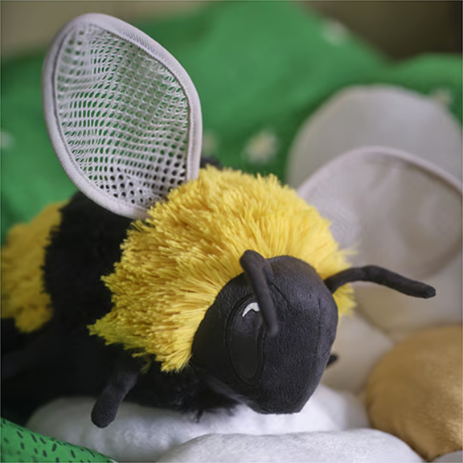

<div align="center">
<br>

<hr>

**[skogsduva.club](https://skogsduva.club)** — fanpage of the Skogsduva bees. be soft. pollinate one good vibe per day.

  
</div>

## What this is

A single static page about an IKEA plushie bee that lives in a Slack workspace. No framework, no build step, no JavaScript: one `index.html`, one stylesheet, two images. It loads fast because there is nothing to load.

The page carries:

- an about section ("skogsduva" is Swedish for *forest dove*; the bee is not a dove)
- vital stats (species, size, designer, washing instructions)
- silly facts
- a short faq

## Structure

```
index.html            the whole site
CNAME                 custom domain for GitHub Pages (skogsduva.club)
assets/
  profile.png         plushie portrait, also the OpenGraph image
  favicon.png
  css/style.css       all the styling
  fonts/              self-hosted fonts
```

<details>
<summary>design notes</summary>

- palette built around `#f0b429` (bee yellow), also used as `theme-color`
- typefaces: Bricolage Grotesque for text, JetBrains Mono for the stat table
- full OpenGraph + Twitter card metadata so links unfurl nicely in Slack
- `rel="canonical"` points at `https://skogsduva.club/`
</details>

## Development

No tooling required. Clone it and open the file:

```bash
git clone https://github.com/skogsduva/skogsduva.club
cd skogsduva.club
open index.html
```

For a local server (nicer for relative paths and testing metadata):

```bash
python3 -m http.server 8000
# http://localhost:8000
```

## Deploy

Served as a static site on the apex domain declared in [`CNAME`](./CNAME). Pushing to `main` is the deploy.

## Credits

Plushie designed by Malin Gyllensvaan for the IKEA SKOGSDUVA collection. Real bees do the actual work — this repo just does the merch.
